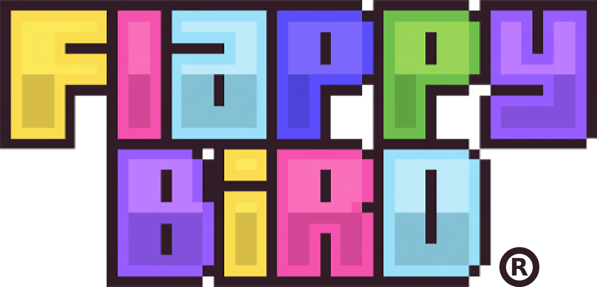
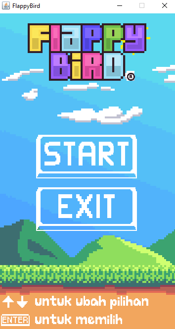
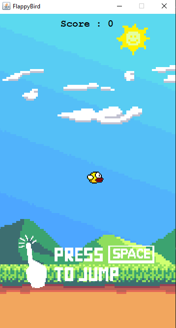
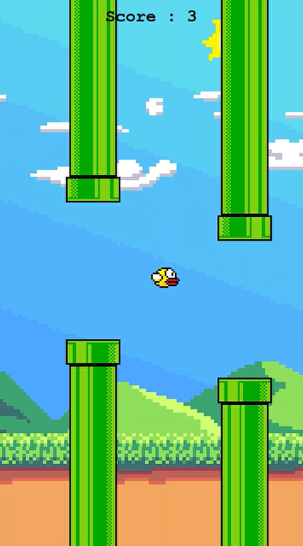
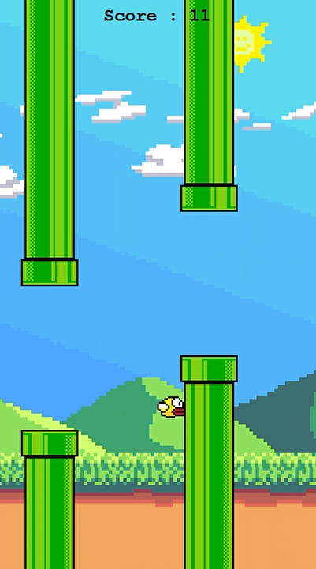
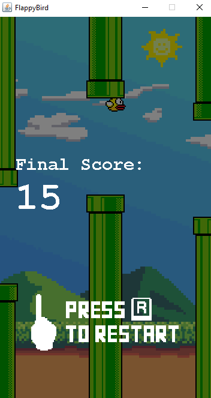
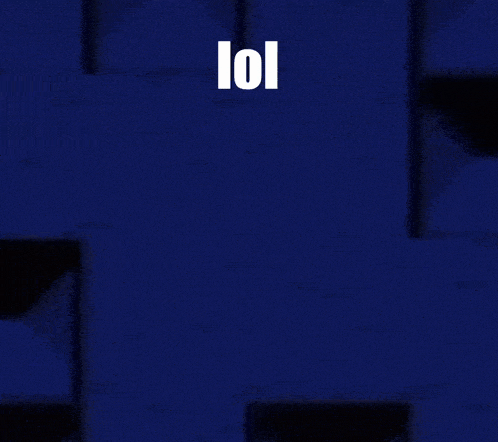

> "Saya Rama Taufik Azkia dengan NIM 2508497 mengerjakan Tugas Praktikum 6 dalam mata kuliah Desain dan Pemrograman Berorientasi Objek untuk keberkahanNya maka saya tidak melakukan kecurangan seperti yang telah dispesifikasikan. Aamiin."

*— Janji*

# GARIS BESAR DESIGN
Flappy Bird merupakan game simpel klasik yang terkenal, dimana anda mengendalikan seekor burung untuk terbang menghindari pipa-pipa. Repositori ini merupakan Flappy Bird *clone* yang saya buat untuk memenuhi tugas sekaligus berlatih menggunakan Java Swing.

Program terdiri dari 8 kelas:
  1. `App`, kelas utama tempat *function* `main`;
  2. `Logic`, kelas yang mengatur logika permainan. Perhitungan skor, *input* pemain, *collision*, semuanya diatur disini;
  3. `Object`, kelas parent untuk segala objek bergerak yang muncul *in*-*game*, meliputi:
    - `Player`, kelas yang merupakan objek pemain alias sang burung kuning. Memiliki tambahan atribut `velocity_y` karena pemain hanya bergerak ke atas atau ke bawah;
    - `Obstacle`, objek yang menjadi penghalang (dalam hal ini, pipa). Memiliki tambahan atribut `is_passed` yang menjadi *flag* apakah penghalang sudah terlewati atau belum;
    - `ParallaxBackground`, objek yang menjadi *background* bergerak, seolah-olah ada kedalaman (*parallax*). Memiliki tambahan atribut `velocity_x` karena *background* bergerak dari kanan ke kiri sehingga pemain nampak maju walau hanya bergerak ke atas dan bawah saja.
  4. `SoundManager`, kelas yang mengatur segala macam suara, termasuk *background music* (BGM) dan *sound effects* (SFX). Semua metode di kelas ini dibuat statis agar bisa langsung dipanggil dengan mudah tanpa instantiasi;
  5. `View`, kelas yang menggambar tampilan layar, termasuk UI, pemain, *obstacle*, *background*.

  Dari metode `main` di kelas `App`, aplikasi ini akan membuat satu `View` dan `Logic`. Pada `Logic` sendiri, permainan diatur dengan sistem `game_state` untuk pergantian *state* dari menu menuju bermain, dari bermain ke *game over*, dsb. `game_state` tersebut dapat bernilai:
  
| `game_state` | Deskripsi | Tampilan |
| --- | --- | --- |
| 0 | Menu awal |  |
| 2 | Awal permainan / Persiapan |  |
| 1 | Permainan utama |  |
| -2 | Menabrak *obstacle* / Menyentuh tanah |  |
| -1 | Game over |  |

Otomatis *state* ini juga akan berpengaruh pada `View`, menentukan apa yang digambarkan sesuai dengan *state* saat ini. Dari kelas `Logic` sendiri akan membuat satu `Player` dan sebuah *arraylist* `Obstacle`, dimana ia juga akan menentukan letak celah yang bisa dilewati pada tiap pasang `Obstacle`. Agar tidak menumpuk, `Obstacle` yang sudah keluar layar akan langsung dihapus. 

*Collision* atau tabrakan sendiri dihitung dari 4 (2 pasang, atas dan bawah) `Obstacle` pertama, dikarenakan jika `Obstacle` yang keluar layar langsung dihapus, dipastikan dalam satu waktu tidak mungkin ada lebih dari 4 `Obstacle` di sisi kiri dan yang akan dilewati pemain. Ke 4 `Obstacle` yang dipilih ini pun sebenarnya tidak semuanya dihitung. Begitu pemain melewati `Obstacle`, maka `Obstacle` tersebut diberi *flag* true pada atribut `is_passed`-nya, yang menandakan sudah tidak perlu dihitung karena pemain tidak mungkin melewati `Obstacle` tersebut lagi.

Terakhir dalam kelas `Logic`, juga akan memanggil kelas `SoundManager` untuk memainkan BGM atau SFX.

Untuk `ParallaxBackground` sendiri tidak disimpan dalam `Logic`, melainkan dalam `View`, dimana *background* terdiri dari 5 lapisan (walau 2 lapisan bergerak dalam kecepatan yang sama), yaitu: Langit, awan, pegunungan, dataran jauh, dan dataran dekat. Mereka semua bergerak dari kanan ke kiri, namun dalam kecepatan yang berbeda sehingga menimbulkan seolah-olah ada kedalaman layaknya 3 dimensi.

# ALUR
Saat pertama kali menjalankan aplikasi, pengguna akan disambut menu seperti berikut:

Pada awalnya, ditampilkan 2 buah tombol (bukan komponen Swing sehingga tidak bisa ditekan manual), START dan EXIT. Seperti yang terlihat di bawah layar, menekan tombol panah atas atau bawah akan menggerakan pilihan tombol pada menu dan tombol *Enter* akan memilih tombol yang sedang dipilih (ditandakan dengan ukuran yang menjadi sedikit lebih besar). Permainan akan dimulai ketika pemain memilih tombol START. Lalu tampilan berubah menjadi berikut:

Disini gravitasi belum aktif dan penghalang belum muncul, dan untuk benar-benar memulai, mulai terbang dengan menekan spasi. *Background* akan mulai bergerak, gravitasi aktif, dan penghalan mulai bermunculan. Arahkan sang burung agar tidak menabrak pipa dan tidak terjatuh ke tanah. Setiap pasangan pipa yang dilewati memberikan +1 skor. Ketika pemain menabrak pipa atau terjatuh ke tanah, maka permainan akan berhenti sejenak sebelum menampilkan layar *game over* berikut:

Dari sini, pemain bisa menekan tombol R untuk mengulang permainan lagi, dan seterusnya sampai puas.

# DOKUMENTASI
<video src="docs/gameplay.mp4" controls="controls" style="max-width: 50%;"></video>

# CATATAN
*All credits go to:* 

*The original creator of Flappy Bird, Dong Nguyen*

*Flappy Bird (2024 remake) for logo*

*Toby Fox for background musics and sound effects*

